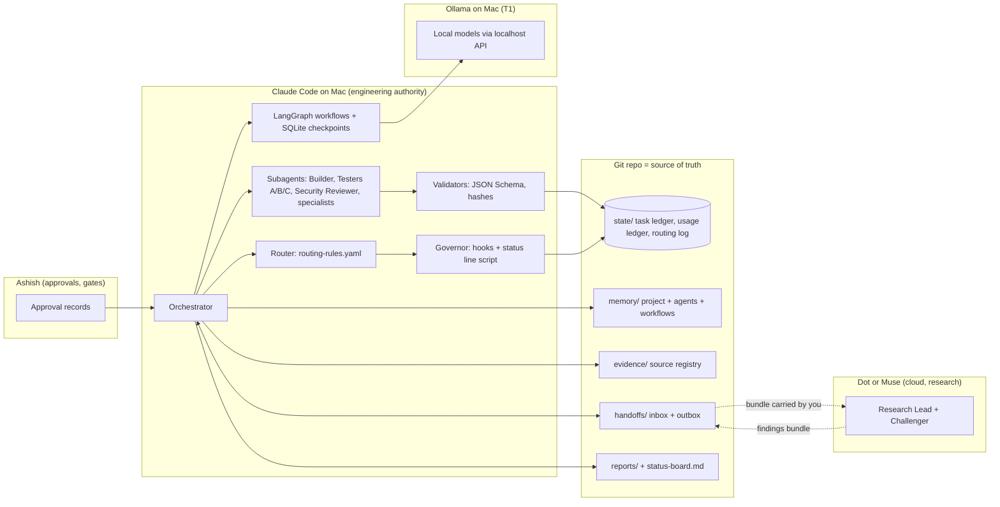
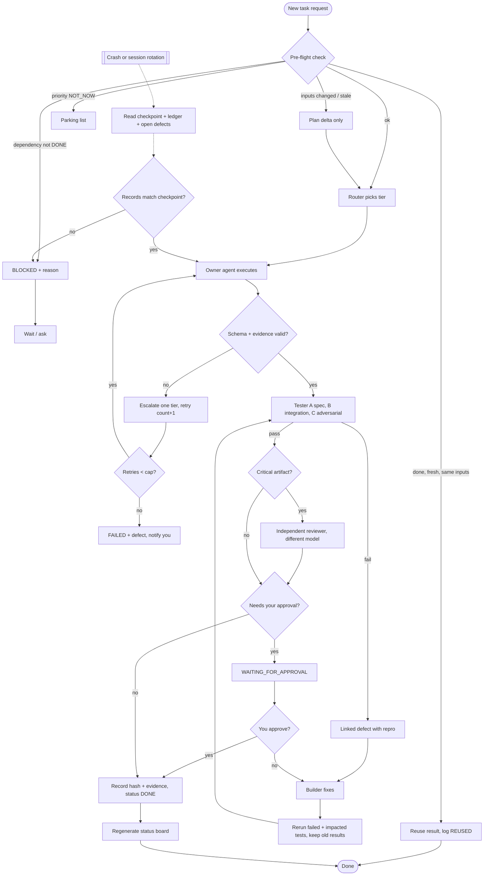

# 03 · Architecture, roles, environment split and handoff contract

## 3.1 Environments actually found (Section 1: discover, don't assume)

| Environment | What was verified on 2026-10-18 | Shared storage with others? |
|---|---|---|
| **Claude Code** | Installed on your Mac and used for this repo (git history: 3 commits). Status line JSON, 30+ hook events, OTel metrics, per-subagent `model` and `tools` [SRC-30..33]. Runs Claude models only. | Reads/writes the local git repo. |
| **DOT_MUSE = Meta Muse** (updated from [P1-MUSE-01](muse/P1-MUSE-01.json), self-tested 2026-10-17) | Model **Muse Spark 1.3**; context 350,000 tokens, auto-compaction ~272k (runtime-reported). **YES:** live web search with source URLs; reads uploaded md/json/csv/pdf (non-image ≤ ~25 MB); produces downloadable md/json/csv; runs code in its own Linux VM (not your Mac or repo). **PARTIAL:** memory across chats (curated notes only, search can lag); GitHub/other connectors (connection `NOT_TESTED`); usage reporting (live context % only, no per-task tokens). **Limits:** free plan, weekly allowance 100% used until 2026-10-22 03:42 EDT, extra token balance ~1.9B remaining. Whether a separate "Dot" exists is open (Muse's Q3 to you). | **None.** You are the transport: bundles are uploaded to and downloaded from Muse by hand. |
| **Ollama** | **Measured 2026-10-18 on your Mac:** Apple M1, 8 GB RAM, macOS 26.6.2, 27 GB free disk; Ollama 0.40.3; models `qwen2.5:3b` (1.9 GB) and `qwen2:7b` (4.4 GB); nothing loaded. Muse's "M1 / 8 GB" claim is confirmed. A 7B model leaves little RAM for anything else; `qwen2.5:3b` is the only realistic T1 candidate, for small classification/extraction jobs. **Design change:** the system runs on two environments by default; T1 switches on only after the capacity check and golden tasks pass. API returns `prompt_eval_count`, `eval_count`, durations; supports JSON-schema `format` [SRC-34]. | Called from Claude Code / scripts over `localhost:11434`. No memory of its own. |

**Canonical source of truth:** the `agent-business-os` git repo on your Mac. Claude Code is its only direct writer. Dot/Muse and Ollama never write to it directly: their output arrives as handoff bundles that Claude Code validates and commits.

## 3.2 Agent roster (small on purpose)

| Agent | Where it runs | Default tier | Owns | Reviewed by |
|---|---|---|---|---|
| **Orchestrator** | Claude Code main session | T4 for planning, T3 for routine | Task assignment, ledger writes, gates, status board | You (gates) |
| **Context & Token Governor** | Scripts + hooks (T0); LLM only for checkpoint summaries | T0 / T2 | Usage ledger, context thresholds, budgets, waste report | Orchestrator |
| **Model Router** | Script + `routing-rules.yaml` (T0) | T0 | Routing log, tier choice, escalations | Orchestrator |
| **Builder** (developer) | Claude Code subagent | T3 | Code, schemas, scripts | Tester A/B/C |
| **Tester A** spec/unit · **Tester B** integration/persistence · **Tester C** adversarial/regression | Claude Code subagents + deterministic test runner | T0 runner, T2–T3 for test design | Test registry, defects | Orchestrator |
| **Research Lead** | Muse (via handoff) | T4 | Research plans, decision framing, option matrices, web synthesis with citations, source ledger drafts (filed into `evidence/` only by Claude Code) | Challenger |
| **Challenger / red team** | A different model+prompt from the author (Muse if Claude authored, Claude if Muse authored) | T4 | Dissent records (Muse's first: [P1-MUSE-02](muse/P1-MUSE-02.json); P1-MUSE-03 will review this report) | Orchestrator → you |

**Never routed to Muse** (you asked: nothing it marked NO or PARTIAL, plus what it said it should not own): running or verifying code/tests for the repo, holding project state or memory (every bundle carries the records it needs), GitHub or other connector work, usage metering, external actions or contacts, definitive regulatory/legal calls.
| **Local Extractor** | Ollama | T1 | Schema-bound extraction/classification with source IDs | Schema validator (T0) + sampled T3 check |
| **Security Reviewer** | Claude Code subagent with OWASP plays, read-only tools | T4 | Threat model, pre-adoption reviews | You |
| **Business specialists** (regulatory, finance, supplier, GTM) | Created on demand per task in Phase 4, from templates | T3–T4 | Their task artifacts | Specialist + challenger; humans sign off regulated items |

## 3.3 Diagram 1 — System architecture



## 3.4 Diagram 2 — Task workflow with review, fix, regression, failure and resume



## 3.5 Diagram 3 — Work routing and data handoff across environments

```mermaid
sequenceDiagram
  autonumber
  participant Y as You
  participant O as Orchestrator (Claude Code)
  participant R as Router (script)
  participant L as Ollama (local)
  participant D as Dot or Muse
  participant G as Git repo

  Y->>O: Request / approval
  O->>G: Read status board, ledger, checkpoint
  O->>R: Route task (type, risk, privacy, size)
  R-->>O: Tier + environment + reason
  alt T0 deterministic
    O->>O: Run script, record result
  else T1 local
    O->>L: Prompt + JSON schema + source IDs only
    L-->>O: JSON + token counts
    O->>O: Validate; fail closed or escalate
  else Research (Dot or Muse)
    O->>G: Write handoffs/outbox/TASK-x.json + .md
    O-->>Y: "Carry this bundle to Dot/Muse"
    Y->>D: Upload bundle
    D-->>Y: Findings bundle (sources, evidence IDs)
    Y->>G: Drop into handoffs/inbox/
    O->>G: Validate schema, freshness, evidence; ACK
  else T2-T4 Claude subagent
    O->>O: Subagent with model + tool allowlist
  end
  O->>G: Update ledger, usage, routing log, evidence
  O-->>Y: Status board + approvals needed
```

## 3.6 Handoff contract

The Section 4 envelope is adopted unchanged as `handoff_schema_version: "1.0"`, plus two fields Section 6B and 10 require:

- `product_id` (e.g. `PRD-COFFEE-PROTEIN`, `PRD-PLATFORM` for system work) alongside `project_id`.
- `task_key` (the dedup hash from the pre-flight check).

Draft JSON Schema: [schemas-draft/handoff.schema.json](schemas-draft/handoff.schema.json).

`product_id` and `task_key` are **optional on the wire** and filled in by the receiver, because senders outside the repo (Muse) can't compute repo hashes. External IDs (`P1-MUSE-01`, `TEST-web-search-20261017`) are accepted and mapped to internal `TASK-*` / `EXT-*` IDs at ACK. Every bundle must also carry the sha256 of the repo files it read (e.g. `PROMPT.md` = `33d8bc4b…27f2` today), so freshness can be checked. First real use: [muse/ACK-P1-MUSE-01-02.md](muse/ACK-P1-MUSE-01-02.md).

Receiver protocol (deterministic script, T0):
0. Secret scan the pasted/uploaded bundle before saving it (the human relay is an attack surface, see threat model).
1. Validate against schema version; reject unknown versions → `BLOCKED`.
2. Verify every `inputs[].version_or_hash` matches the repo; mismatch → `BLOCKED`, request the artifact.
3. Check every `evidence_ids` exists in `evidence/` and is within its freshness window.
4. Scan free-text fields for instruction-like content (e.g. "ignore previous", "run this command"); flag, never execute.
5. Write an ACK record and update the ledger. Only then may an agent act on it.

Naming convention: `TASK-0001`, `SRC-0001`, `TEST-0001`, `DEF-0001`, `DEC-0001`, `APR-0001`, `HO-<task>-<seq>`; artifacts `reports/<phase>/<yyyy-mm-dd>-<slug>.<ext>`.

## 3.7 Directed communication

Specialists never message each other. All traffic is `specialist → Orchestrator → specialist` via ledger records and handoffs. The Governor and Router write only to their ledgers; the Orchestrator reads them before each dispatch (Section 9.4). Disagreements: specialist → Orchestrator → you if material.
