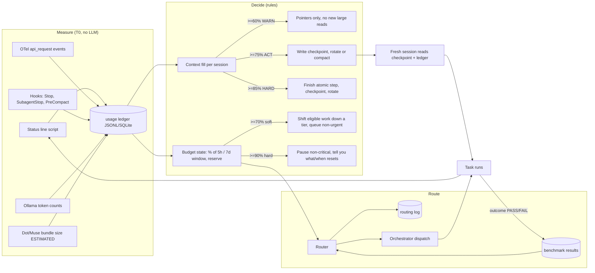

# 04 · Context & Token Governor and Model Router (Section 9)

## 4.1 Measurement points actually found

| Environment | Measurement point | What it gives | Status | Source |
|---|---|---|---|---|
| Claude Code | **Status line stdin JSON** | `context_window.used_percentage`, `context_window_size`, `current_usage.{input,output,cache_creation,cache_read}_tokens`, `cost.total_cost_usd`, `rate_limits.five_hour.used_percentage` + `resets_at`, `rate_limits.seven_day.*`, `spend_limit.*`, `prompt_cache.*`, `model.id`, `session_id`, `agent.name` | Documented; `NOT_TESTED` on your Mac | SRC-30 |
| Claude Code | **OpenTelemetry** | Metrics `claude_code.token.usage` (type input/output/cacheRead/cacheCreation, model, agent/skill/MCP attribution), `claude_code.cost.usage`; event `claude_code.api_request` per request with tokens, cost, duration. Exporters: otlp, prometheus, console | Documented; `NOT_TESTED` | SRC-32 |
| Claude Code | **Hooks** | `SessionStart` (on resume: `context_tokens`, cache-expired flag), `PreCompact` (can block, matcher manual/auto), `PostCompact`, `SubagentStart/Stop`, `Stop`, `PreToolUse` (allow/deny/ask), `PreModelSwitch`; every hook gets `session_id`, `transcript_path`, `agent_id/agent_type` | Documented; `NOT_TESTED` | SRC-31 |
| Claude Code | `/usage`, `/context` | Session tokens by model, cache stats, plan bars, attribution to subagents/skills/MCP (last 24h / 7d, this machine only) | Documented | SRC-33 |
| Claude Code | Subagent `model` field, `CLAUDE_CODE_SUBAGENT_MODEL` (+ `_FORCE`) | Per-agent model switching that really happens automatically | Documented | SRC-35 |
| Claude Code | Local transcripts JSONL (read by ccusage) | Per-message usage history | Documented by ccusage; `NOT_TESTED` | SRC-23 |
| Ollama | `/api/chat`, `/api/generate` final response | `prompt_eval_count`, `eval_count`, `prompt_eval_cached_count`, `*_duration` (ns) | Documented | SRC-34 |
| Muse (DOT_MUSE) | Live context-fill % of the current chat; subscription-status check (weekly allowance %, reset time, extra token balance). No per-task token counts. | Per-task usage **ESTIMATED** (bundle characters sent + received ÷ 4, plus Muse's context % before/after, both logged); plan state **MEASURED by Muse** and copied into each bundle's `model_and_tool_usage` | P1-MUSE-01 items 7–9 |

**Plan limits:** not hardcoded. The status line reports live `five_hour` and `seven_day` used % and reset times, so budgets are expressed as percentages of those windows and the absolute numbers are read, not guessed. Your plan tier (Pro / Max) is still needed to size daily budgets (blocking Q2).

**Context windows:** read per session from `context_window_size`; the registry stores the observed value with date. No number is written into config until observed.

## 4.2 Diagram 4 — usage → context → routing control loop



## 4.3 Governor design

- **Sensors:** the status line script appends one JSON line per refresh (debounced to state changes ≥1% or new session) to `state/context-sessions/<session_id>.jsonl`; hooks append usage on `Stop`/`SubagentStop`; a nightly roll-up (T0) builds per agent / task / model / day tables.
- **Attribution:** the task ID is carried in the session name (`/rename TASK-0007`) and in subagent names, so `session_name` and `agent.name` from the status line map tokens to a task. Unattributed calls are counted; target ≥95% attributed.
- **Thresholds (config, tunable):** context WARN 60 / ACT 75 / HARD 85; budget soft 70 / hard 90; reserve 20% of each window kept for review gates, regression tests, checkpoints and anything you mark urgent.
- **Rotation without loss:** `PreCompact` hook writes a checkpoint (handoff envelope + pointers) before any auto-compaction; `SessionStart` (source `resume`/`compact`) injects a pointer to that checkpoint so the new context starts from records. A mismatch between checkpoint and ledger → `BLOCKED`.
- **Waste detectors (T0 scripts over the ledger/transcripts):** same file read ≥2× unchanged in a session; tool output >10k tokens; whole-file reads of files >500 lines; re-research of evidence still fresh; T3/T4 used on a task type whose benchmark passes at T1/T2; retry loops >2; prompt-cache miss causes reported by `prompt_cache.last_miss_cause`.
- **Authority:** may warn, checkpoint, rotate, queue/pause non-critical work and propose optimizations. May not delete work, skip gates, lower a critical floor, adopt its own optimization without eval evidence, or change budgets/plans.
- **Reporting:** `reports/usage/<date>.md` + CSV, generated by script; a message only on threshold crossing and a daily summary.

## 4.4 Router design

**Tiers** (Section 9.3): T0 code · T1 Ollama · T2 small cloud (Claude Haiku-class) · T3 mid (Claude Sonnet-class) · T4 top (Claude Opus-class, Dot/Muse deep research). Vendor names are examples; the registry decides.

**Routing matrix (initial, before benchmarks — conservative start):**

| Task type | Risk | Privacy | Start tier | Floor | Independent reviewer |
|---|---|---|---|---|---|
| Calculations, hashes, dates, state transitions, test execution, dedup by rule | any | any | T0 | T0 | — |
| Schema extraction from supplier PDFs / catalogs | STANDARD | private allowed local | T1 | T1 | T0 schema check + 10% T3 sample |
| Review-theme coding, classification, triage | LOW | any | T1 | T1 | T0 schema check |
| Short summaries with source IDs | LOW | public | T2 | T1 | — |
| Routine code edits, docs | STANDARD | public | T3 | T2 | Tester A |
| New code, schemas, workflows | STANDARD | public | T3 | T3 | Testers A/B/C |
| Market/competitor research synthesis | STANDARD | public | T4 (Dot/Muse) | T3 | Claude challenger |
| Architecture approval, security review | CRITICAL | public | T4 | T4 | Different model/provider |
| Regulatory/quality matrix | CRITICAL | public | T4 | T4 | Different provider + **human professional** |
| Financial model, go/no-go, supplier shortlist | CRITICAL | private | T4 (cloud only with your approval) | T4 | Different provider + you |
| Anything with private content and no approval | any | private | T0/T1 | — | else `BLOCKED` |

**T1 is off until proven.** Until the Ollama capacity check and golden tasks pass, every T1 row above runs at T0 where a script can do it, otherwise at T2, and private-content rows that would need T1 are `BLOCKED` instead of going to the cloud. This follows Muse's risk 3: the matrix works with two environments.

**Rules:** lowest tier that passed its golden tasks; escalate one tier on schema failure, missing evidence, reviewer rejection or ≥2 retries (logged); de-escalate only with before/after eval evidence; critical tasks wait rather than drop below floor; on rate limit → queue, switch to an approved equal-or-higher tier, or pause with checkpoint.

**What switches automatically vs. needs you:**

| Switch | Automatic? |
|---|---|
| Subagent model per task (frontmatter `model` or per-invocation parameter) | Yes |
| Script → Ollama call | Yes |
| Main session model (`/model`) | Needs a human action (or `PreModelSwitch` hook can only block). Router recommends. |
| Move work to Dot/Muse | No — Router writes a handoff bundle; you carry it. |

**Draft model registry** (`config/model-registry.yaml` in Phase 2; values marked `TO_MEASURE` are filled from the status line / `ollama show`, never guessed):

```yaml
- id: claude-opus-5-5        # T4
  environment: CLAUDE_CODE
  context_window: TO_MEASURE
  status: ACTIVE
  source: "Claude Code subagent docs (model aliases); checked 2026-10-18"
- id: claude-sonnet-5-5      # T3
  environment: CLAUDE_CODE
  context_window: TO_MEASURE
  status: ACTIVE
- id: claude-haiku-5-5       # T2
  environment: CLAUDE_CODE
  context_window: TO_MEASURE
  status: ACTIVE
- id: qwen2.5:3b              # T1 candidate (installed, 1.9 GB)
  environment: OLLAMA_LOCAL
  host: Apple M1, 8 GB RAM, Ollama 0.40.3 (measured 2026-10-18)
  context_window: TO_MEASURE   # num_ctx actually configured
  quantization: TO_MEASURE     # from `ollama show`
  status: CANDIDATE            # ACTIVE only after golden tasks pass
- id: qwen2:7b                 # installed, 4.4 GB; likely too heavy for 8 GB alongside other apps
  environment: OLLAMA_LOCAL
  status: NOT_NOW
- id: muse-spark-1.3          # T4 research + challenger only
  environment: DOT_MUSE
  context_window: 350000       # runtime-reported by Muse, 2026-10-17
  auto_compaction_at: ~272000  # runtime-reported
  usage_measurement: ESTIMATED
  plan: free; weekly allowance 100% used, resets 2026-10-22T03:42-04:00; extra balance ~1.9B tokens
  allowed_tasks: [research_synthesis, research_planning, option_matrix, challenger_review, tutoring, handoff_packet]
  forbidden_tasks: [code_or_test_verification, state_of_record, memory_dependent, github_or_connectors, usage_metering, external_actions, legal_regulatory_final]
  status: ACTIVE
  source: "handoff P1-MUSE-01 (sha256 00350acb…4ca4), received 2026-10-18"
```

**Muse budget rule:** until 2026-10-22 every Muse task draws on the extra balance, so the Router batches Muse work into few, larger bundles and sends only `MUST` research. Challenger review of this report (P1-MUSE-03) is the one Muse task worth running before then.

## 4.5 Initial budgets (config draft, all tunable)

```yaml
windows:            # read live from status line rate_limits
  five_hour: {soft_pct: 70, hard_pct: 90, reserve_pct: 20}
  seven_day: {soft_pct: 70, hard_pct: 90, reserve_pct: 20}
per_session_context: {warn_pct: 60, act_pct: 75, hard_pct: 85}
workstream_share_of_daily:   # percentages of what remains outside reserve
  platform_build: 50
  research: 30
  governance_overhead: 5     # Governor/Router own LLM use; target < 5%
  slack: 15
retry_cap: 2
source: "PROMPT.md 9.2 defaults; Claude Pro plan confirmed by Ashish 2026-10-18"
# Pro plan: smaller 5h/7d windows than Max, so default work runs on Sonnet-class (T3);
# Opus-class (T4) only for CRITICAL rows; verbose work in subagents.
```

## 4.6 Token-saving strategy (expected savings are ESTIMATES)

| Lever | How | Expected effect | Proof required |
|---|---|---|---|
| Pointers not pastes | Handoffs carry paths + hashes; agents read line ranges | ESTIMATED 20–40% fewer input tokens on multi-step tasks | Golden tasks before/after |
| Keep CLAUDE.md small, move procedures into skills | Skills load on demand [SRC-33] | ESTIMATED small but on every turn | Same |
| Filter tool output in hooks | e.g. tests print failures only [SRC-33] | ESTIMATED large on test-heavy turns | Same |
| Verbose work in subagents | Only summaries return to main context [SRC-33] | Main-context savings; total may rise | Same, plus total tokens |
| T0 scripts for repeatable work | Never an LLM for math/state/dedup | Removes those tokens entirely | Output equality test |
| T1 Ollama for bounded extraction | Only after benchmark | Cloud tokens → local compute | Schema-valid rate ≥ T2 baseline |
| Prompt-cache hygiene | Stable tool set and prefix; watch `last_miss_cause` | Fewer cache rebuilds | Cache hit ratio from status line |
| Fewer, smaller agents | Anthropic reports ~15× chat tokens for multi-agent [SRC-40] | Avoids the biggest multiplier | Usage per task |

No lever is adopted without the Section 9.2.5 before/after golden-task test (zero acceptance regressions, zero lost evidence IDs, zero new schema failures).
